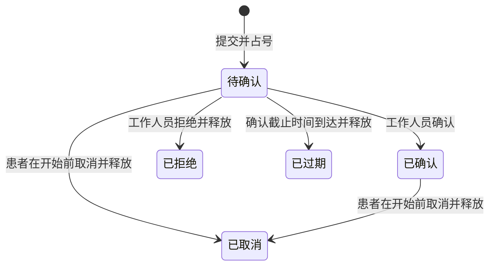

# M1 预约演示：规则与验收

确认日期：2026-09-28。用户已确认以下开发演示口径，正式试点前由院方结合实际运营复核。

2026-10-07 更新：正式员工会话、改期、候补和状态时间线按 [小程序排班预约扩展与验收](小程序排班预约扩展与验收.md) 执行；下文保留原 M1 演示口径，停诊后的确认规则以扩展页为准。

## 预约规则

- 选择未来开放且有余量的时段，填写联系人、手机号及可选备注后提交。
- 提交成功创建“待确认”预约，立即占用一个名额。待确认不等于预约已确认。
- 工作人员确认后变为“已确认”，不再次占用名额；拒绝必须填写原因并释放名额。
- 就诊开始前，患者可以取消自己的待确认或已确认预约；取消立即释放名额。
- 待确认保留最多 120 分钟，且不晚于时段开始。到期自动变为“已过期”并释放名额。
- 相同患者、相同时段最多存在一条待确认或已确认预约。取消、拒绝或过期后可再次申请。
- 关闭时段阻止新申请，不自动取消已有预约。工作人员仍须逐条处理已有预约。

状态流转：

已确认预约到达就诊时间后，M1 不自动改成“完成”或“爽约”；到院记录将在后续里程碑增加。

## 请求、身份和数据

- 每次提交有独立请求键。同键、同内容返回同一预约；同键、不同内容拒绝，不能重复占号。
- 网络超时先查询原请求。查询暂时无结果时仍可能处理中，重试继续使用原键和原内容。
- 修改预约状态时校验版本；取消、审核或过期相互竞争时，由服务端决定合法结果。
- 当前使用独立演示患者会话，有效期 7 天，数据库只存令牌摘要。前端不能指定其他患者 ID。
- 患者只查本人预约；后台使用固定演示运营身份处理队列。患者令牌与后台令牌不能互换。
- 会话失效后明确提示，重新建立演示身份需要用户操作；旧身份预约不会自动转移。
- 原生微信登录、正式员工登录和真机验证仍需机构账号及后续接入；本地演示服务不接受真实患者资料。

## 实现要求

- 数据库迁移新增预约、会话和操作记录，不重建 M0 院区、医生、排班数据。
- 预约占号/释放、版本和操作记录在同一事务内提交。
- 使用行锁和唯一约束保证最后一个名额不超约、相同患者不重复活跃预约。
- 到期预约通过周期任务处理，应用重启后补偿；查询和业务操作时也校正过期状态。
- `PENDING_CONFIRMATION_MINUTES` 默认 120。修改配置只影响后续新建预约，已建预约沿用保存的截止时间。
- 时间统一按北京时间显示；手机号、备注和会话令牌不写入常规日志。

数据库的条件唯一约束采用生成列：仅待确认/已确认时参与唯一索引，其他状态生成 NULL。依据 MySQL 的[生成列索引](https://dev.mysql.com/doc/refman/8.4/en/generated-column-index-optimizations.html)和[唯一索引的 NULL 规则](https://dev.mysql.com/doc/refman/8.4/en/create-table.html)。

## 验收清单

- 小程序提交 → 后台查看并确认 → 小程序刷新显示已确认。
- 后台拒绝并填写原因 → 小程序显示原因 → 名额恢复。
- 待确认或已确认预约可在开始前取消，名额只释放一次。
- 连点、超时重试、相同请求并发均不多建预约；修改原请求内容返回冲突。
- 两名患者争最后一个名额，仅一人成功；同患者换请求键也不能重复占同一时段。
- 患者不能读取或取消另一患者的预约，也不能调用后台审核接口。
- 过期会话无效；过期预约不能被确认；停止后重启可补处理到期预约。
- 后台版本冲突刷新详情，小程序保留可恢复的未知请求。
- 原生模拟器核对页面实际渲染，浏览器核对操作结果，继续回归 M0 排班功能。

执行结果记录在 [开发进度](./开发进度.md)。本页定义验收要求，不把尚未运行的检查记作通过。
